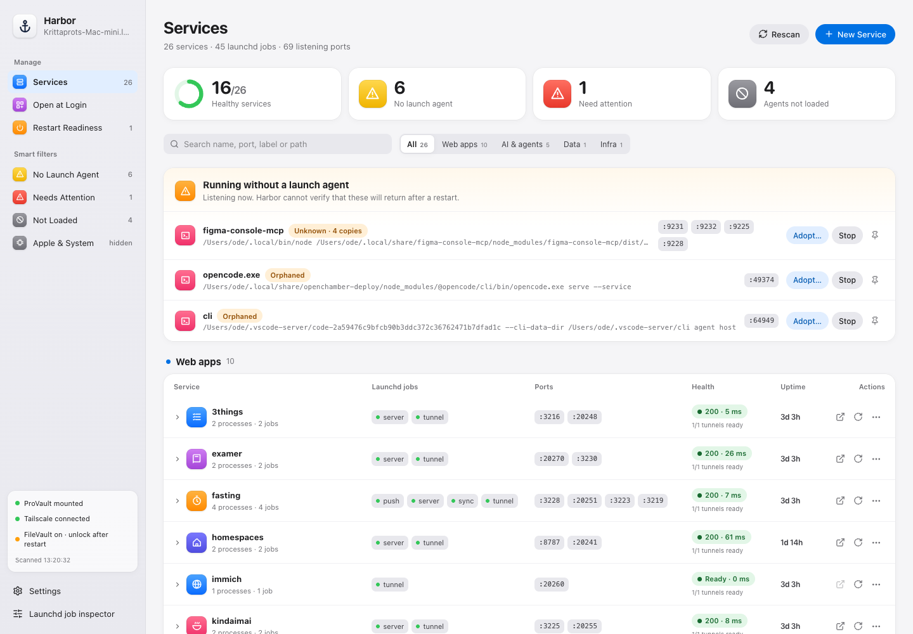

# Harbor

A native macOS app for seeing what's running on your Mac: launchd services, listening
ports, unmanaged processes, login apps, and restart readiness.

Built with Tauri, React and Rust. Forked from [azu/launchd-ui](https://github.com/azu/launchd-ui)
and released under the [MIT license](LICENSE).



## Features

- **Services:** grouped launchd jobs, process trees, port ownership, HTTP/TCP health checks,
  and Cloudflare tunnel readiness.
- **Unmanaged processes:** identify listeners without a launch agent, inspect a generated
  plist, and adopt them after confirming the preview.
- **Open at Login:** login apps, background helpers, leftover installations and unloaded agents.
- **Restart Readiness:** a checklist, saved snapshots and post-boot comparisons.
- **Menu bar:** pinned services, status indicators and notifications.
- **Job inspector:** plist editing, scheduling, logs and user-agent controls retained from upstream.
- System light/dark appearance and a native Harbor app icon.
- **Agent CLI:** headless inventory, health, logs, snapshots and explicit service controls with versioned JSON.

Harbor runs at user level. System agents and daemons are read-only. Process termination uses
identity checks and SIGTERM; service and Mac restarts require confirmation.

## Status

Early development; testing is ongoing. See [verification](docs/VERIFICATION.md) for the checks
performed and remaining acceptance work. The screenshots are renders of the running app's
exported DOM/CSS with live data, rather than native desktop captures.

Harbor was initially built for a particular Mac mini. Some defaults reflect that machine,
including `/Volumes/ProVault` readiness and example service groups. Group names, health URLs,
dependencies and menu-bar pins can be customized in `services.toml`.

## Download and install

Download the matching **Apple Silicon (M-series) or Intel DMG** from
[GitHub Releases](https://github.com/krittaprot/harbor/releases/latest).
Open the DMG and drag **Harbor.app** into **Applications**, then launch it there.
Use the `_aarch64.dmg` file for Apple Silicon, or `_x64.dmg` for Intel.

The app is **ad-hoc signed, not Apple-notarized**. macOS may block the first launch:
after trying to open Harbor, go to **System Settings → Privacy & Security → Open Anyway**
and confirm. Only approve a download you obtained from this repository. The release includes
`SHA256SUMS` for verifying the downloaded DMG.

The app includes the agent CLI at `/Applications/Harbor.app/Contents/MacOS/harbor`.

### Updating Harbor

Starting with v1.5.2, open **Settings → Software updates → Check for Updates**.
Choose **Download & Install**, then **Restart Harbor** when installation finishes.
Updates come from this repository's GitHub Releases and are signature-verified before
installation. Your settings and monitored services stay in place.

For v1.5.1 or earlier, quit Harbor and install the v1.5.2 DMG manually once, replacing
the app in its existing Applications location. In-app installation works from
`/Applications` or `~/Applications`; development builds and disk images can check only.
If a download fails or macOS denies replacement, retry or use the DMG from GitHub Releases.

## Build and run

Requires macOS, Xcode Command Line Tools, Rust 1.90 or newer, Node.js 22.18 or newer,
and pnpm 10.28.2 (the version pinned in `package.json`).

```bash
git clone https://github.com/krittaprot/harbor.git
cd harbor
pnpm install --frozen-lockfile
pnpm tauri build --bundles app --config '{"bundle":{"createUpdaterArtifacts":false}}'
open "src-tauri/target/release/bundle/macos/Harbor.app"
```

Copy the resulting bundle to `~/Applications/` or `/Applications/` to install it. Local builds
are ad-hoc signed, not notarized. To create a local disk image, use
`pnpm tauri build --bundles dmg --config '{"bundle":{"createUpdaterArtifacts":false}}'`.
The override skips updater artifact signing for local builds; release CI creates signed
updater packages. See [release maintenance](docs/UPDATES.md).

Start-at-login and notifications default to on. Startup registration is applied only when
launching an installed bundle; builds inside `target/` do not register themselves. Closing
the main window keeps Harbor in the menu bar; use Settings → Quit Harbor to exit.

macOS may identify Harbor as **“harbor-app”** in its App Background Activity notification.
That is Harbor's GUI executable; the app and startup entry are named **Harbor**.

Configuration and snapshots live in `~/Library/Application Support/Harbor/`. Open at Login
uses macOS Automation permission for System Events. Configuration is read again on each scan.

## CLI for agents

```bash
pnpm cli:install                    # builds and installs ~/.local/bin/harbor
harbor status
harbor services
harbor health crystal-blood
harbor preview restart 3things
harbor temporary figma-console-mcp
harbor review figma-console-mcp
harbor diagnose opencode.exe
harbor preview adopt worker as com.harbor.worker
```

The CLI works without the desktop app running. It shares the app's scanner and mutation
validation. Service changes require `--yes`; `--dry-run` prints the affected jobs. Use
`harbor capabilities` for discovery. Output is readable in a terminal and automatically JSON
when captured by an agent or piped. See [CLI documentation](docs/CLI.md) for all
commands, response fields, exit codes and installation options.

## Development

Run from the project root:

```bash
pnpm tauri dev                         # foreground; stop when finished
pnpm test
pnpm lint
pnpm build
pnpm version:check
pnpm test:release
cargo test --manifest-path src-tauri/Cargo.toml
cargo fmt --manifest-path src-tauri/Cargo.toml --check
cargo clippy --manifest-path src-tauri/Cargo.toml --all-targets --all-features -- -D warnings
```

See the [build plan](docs/PLAN.md), [handoff](docs/HANDOFF.md) and
[native verification instructions](docs/VERIFICATION.md) for architecture and testing details.
Bug reports and contributions are welcome through [GitHub Issues](https://github.com/krittaprot/harbor/issues)
and pull requests. The default development branch is `harbor/main`.

### System status

Harbor checks Tailscale through its local CLI, including when Harbor is launched from
Finder or at login. The helper explicitly selects CLI mode without changing Harbor's
environment. Missing executables, command failures and unreadable status remain **Unknown**.
System status refreshes every 60 seconds during background scanning; **Rescan** requests
a fresh check immediately, including Tailscale and FileVault status.

See the [changelog](CHANGELOG.md) for unreleased improvements and previous release notes.

## License and attribution

[MIT](LICENSE). Copyright (c) azu; Harbor additions copyright (c) 2026 ode.
Harbor builds on azu's [launchd-ui](https://github.com/azu/launchd-ui) v1.4.2 and preserves
its Git history and attribution.
